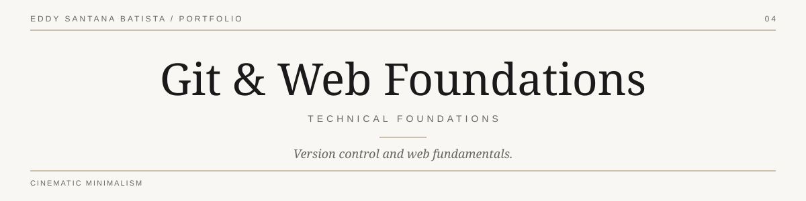

# Git & Web Foundations

Repositorio de práctica de control de versiones y fundamentos de desarrollo web. Contiene una página HTML (`index.html`) y su hoja de estilos (`style.css`). No constituye un caso de análisis de datos.

[Ver portafolio profesional](https://github.com/EddySantanaBootcamp3)
